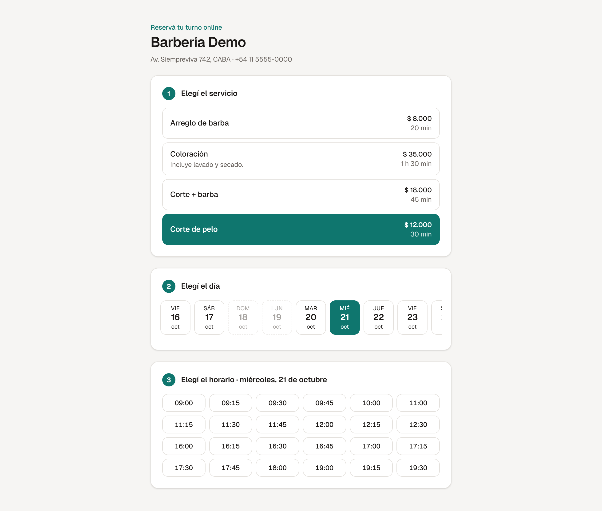
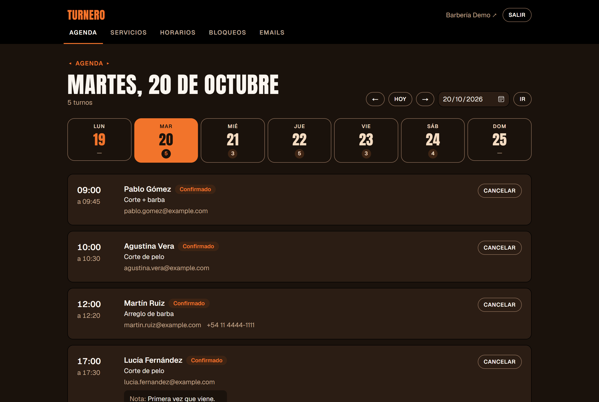
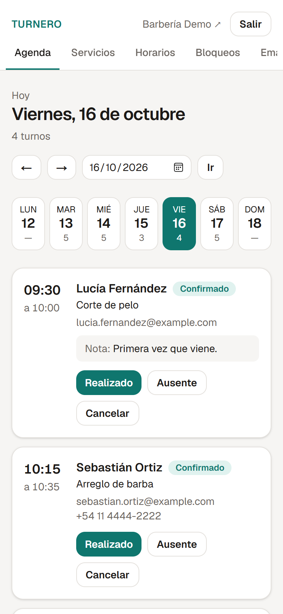
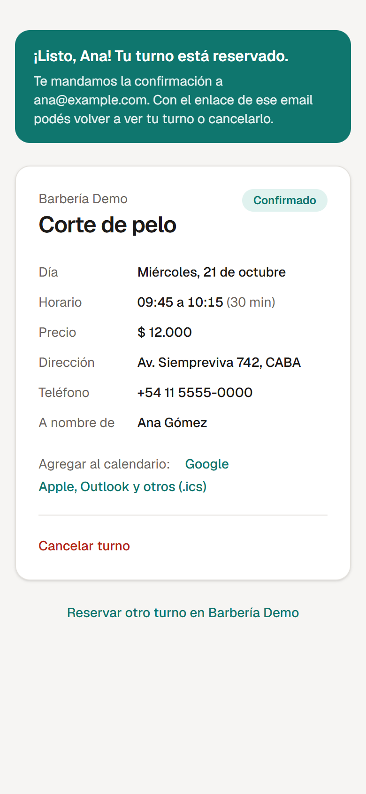
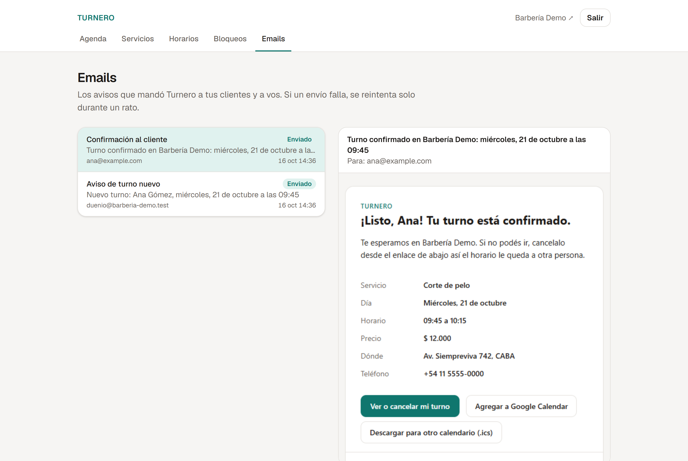
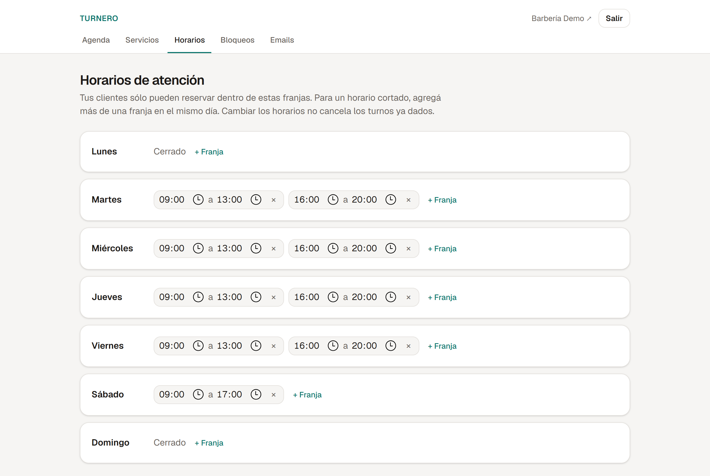

<h1 align="center">📅 Turnero</h1>

<p align="center">
  <strong>Gestor de turnos para negocios locales: el negocio administra su agenda y sus clientes reservan online, sin llamadas ni mensajes.</strong>
</p>

<p align="center">
  
  
  
  
  
  
  <a href="https://github.com/valendotjpg/turnero/actions/workflows/ci.yml"></a>
</p>

<p align="center">
  
</p>

---

## El problema

Una barbería, un consultorio o un estudio de uñas suelen manejar los turnos por WhatsApp o en un cuaderno. Cada reserva es un ida y vuelta de mensajes, los horarios libres sólo los conoce quien atiende, y los errores (dos clientes al mismo horario, un turno olvidado) aparecen en el peor momento.

**Turnero** le da al negocio una página pública donde sus clientes ven los horarios realmente disponibles y reservan solos, y un panel para administrar servicios, horarios de atención y la agenda del día.

## Funcionalidades

**Para el cliente** — disponible
- Página de reservas pública por negocio (`/reservar/<negocio>`)
- Elegir servicio, día y horario entre los que están realmente libres
- Enlace privado para ver o cancelar el turno, sin necesidad de crear una cuenta
- Emails de confirmación, de cancelación y recordatorio 24 horas antes, con enlaces para agregar el turno a Google Calendar o a cualquier calendario (`.ics`)

**Para el negocio** — panel en `/panel`
- Login con sesión
- Agenda por día con resumen de la semana; marcar turnos como realizados o ausentes (y deshacerlo), o cancelarlos
- Servicios con duración y precio; pausar un servicio lo saca de la reserva online sin perder su historial
- Horarios de atención semanales, incluido horario cortado
- Bloqueos de agenda (feriados, vacaciones, un rato): avisa si ya había turnos dados en ese período
- Email por cada turno nuevo o cancelado; si el negocio cancela un turno, el cliente recibe el aviso

## Capturas

| Agenda del negocio | En el celular |
| --- | --- |
|  |  |

| Turno confirmado | Email de confirmación |
| --- | --- |
|  |  |

<p align="center">
  
</p>

Las capturas las genera [`npm run screenshots`](scripts/screenshots.mjs), que recorre la app con un navegador real: reserva un turno, entra al panel y abre el email. Sirve también como prueba de humo de punta a punta.

## Decisiones de diseño

- **La base de datos impide los turnos superpuestos.** Una restricción `EXCLUDE` de PostgreSQL sobre el rango horario de cada turno activo garantiza que dos reservas simultáneas del mismo horario no puedan pasar ambas, aunque lleguen en el mismo milisegundo. La validación de la aplicación mejora la experiencia; la de la base garantiza la consistencia.
- **Fechas en UTC, horarios en la zona del negocio.** Los turnos se guardan como `timestamptz`; los horarios de atención se expresan en minutos desde la medianoche en la zona horaria del negocio, para que funcionen igual en cualquier fecha.
- **La duración del turno se congela al reservar.** Cada turno guarda su hora de fin, así cambiar la duración de un servicio no altera los turnos ya dados.
- **Precios en centavos** (`Int`) para evitar errores de redondeo.
- **El servidor no confía en el horario que manda el formulario.** Al reservar se vuelve a calcular la disponibilidad y se verifica que el horario elegido esté entre los ofrecidos; si dos personas pasan esa verificación a la vez, la restricción de la base frena a la segunda y la aplicación le muestra "alguien acaba de reservar ese horario". Hay un [test](src/server/booking.int.test.ts) que lanza 8 reservas simultáneas del mismo horario y comprueba que gane sólo una.
- **El enlace del turno es un secreto.** El token tiene 192 bits generados con `crypto.randomBytes` (un `cuid` es predecible y no sirve como secreto), la cancelación es un único `UPDATE` condicionado al estado y la página del turno no se indexa.
- **El progreso de la reserva vive en la URL** (`?servicio=…&fecha=…&hora=…`). Cada paso es un enlace: funciona sin JavaScript, el botón "atrás" deshace el último paso y el enlace se puede compartir. Los parámetros se validan contra los datos reales y uno inválido se ignora.

### Autenticación y acceso a datos

- **Sesiones en base, implementadas a mano** en vez de con una librería. La cookie lleva un token aleatorio de 256 bits (`httpOnly`, `SameSite=Lax`, `Secure` en producción) y la tabla `Session` guarda sólo su SHA-256: una copia de la base no alcanza para hacerse pasar por nadie, y cerrar sesión revoca el token de verdad.
- **Contraseñas con `scrypt`** (incluido en Node, con parámetros recomendados por OWASP). El hash guarda sus parámetros, así se pueden endurecer sin invalidar las contraseñas existentes. Un email inexistente tarda lo mismo que uno existente y el error es el mismo, para no revelar qué cuentas hay.
- **Una sola puerta de entrada.** Toda lectura de la sesión pasa por la [capa de acceso a datos](src/server/dal.ts); cada página y cada Server Action del panel la consulta, porque una Server Action es un endpoint que cualquiera puede invocar con un POST. El [`proxy.ts`](src/proxy.ts) sólo hace un chequeo optimista (¿hay cookie?) para redirigir rápido al login.
- **Aislamiento entre negocios.** Las [funciones del panel](src/server/panel) reciben el negocio de la sesión, nunca del formulario, y cada escritura filtra por él en el mismo `UPDATE`/`DELETE`: un id de otro negocio se comporta como inexistente. Los tests de integración crean dos negocios y verifican que uno no pueda tocar los datos del otro.
- **Cambios de estado atómicos.** Las transiciones permitidas de un turno (por ejemplo, "realizado" sólo después de que empezó, y un turno cancelado no se reactiva) se validan en la misma consulta que lo actualiza.

### Emails: outbox transaccional

Los emails no se mandan en el momento de reservar: se **guardan en la tabla `EmailMessage` dentro de la misma transacción** que crea o cancela el turno, y se envían después.

```
Reserva ──┬─ INSERT Appointment ─┐
          └─ INSERT EmailMessage ┴─ COMMIT ──▶ after(): enviar ──▶ SMTP
                                                    │ falla
                                     /api/cron ◀────┘ reintenta: 1, 2, 4, 8 min…
```

- **Si el servidor de correo está caído, la reserva igual se confirma** y el email queda pendiente. Si la transacción se revierte (por ejemplo, el horario se ocupó), no queda ningún email de una reserva que no existió.
- **El envío no demora la respuesta:** se dispara con `after()` de Next.js, apenas se respondió al cliente.
- **Reintentos con espera exponencial** hasta 5 intentos, guardando el último error. Un [cron](src/app/api/cron/route.ts) protegido con un secreto reintenta los pendientes y encola los recordatorios.
- **Un email se envía una sola vez** aunque corran varios workers: cada uno "reserva" el email con un `UPDATE` condicionado al estado, que sólo puede ganar uno. Si un worker muere a mitad del envío, el email vuelve a la cola a los 10 minutos.
- **Recordatorios idempotentes:** cada turno se marca al encolarlo. Sólo se recuerdan los turnos reservados con más de 24 horas de anticipación (quien reservó para mañana acaba de recibir la confirmación).
- **Las plantillas escapan todo lo que escribe el cliente** (un nombre o una nota con HTML no se interpreta) y aplanan el asunto a una línea para que no se puedan inyectar encabezados.

En desarrollo, [Mailpit](https://mailpit.axllent.org/) atrapa todos los emails y los muestra en http://localhost:8025, sin mandar nada a nadie. En producción alcanza con apuntar `SMTP_URL` a cualquier proveedor SMTP (Resend, SES, Postmark…).

### Una demo pública sin riesgos

La cuenta del panel de la demo es pública y cualquiera puede reservar con cualquier email, así que la instancia publicada corre con `DEMO_MODE=true`:

- **Los emails no salen de la app.** Mandarlos convertiría la demo en un relay de spam: alcanzaría con reservar usando el email de otra persona. Se generan igual que en producción y se pueden ver desde el panel (sección *Emails*) y desde la página de cada turno.
- **Límite de intentos por IP** en el login y en las reservas, guardado en Postgres con un único `INSERT … ON CONFLICT` atómico, sin sumar Redis.
- **Los datos se reinician todos los días** con turnos de muestra alrededor de la fecha actual, generados para que nunca se superpongan ni caigan fuera del horario o dentro de un bloqueo (hay un test que lo verifica para cada día de la semana).
- Headers de seguridad básicos (`X-Frame-Options`, `nosniff`, `Referrer-Policy`), para que, por ejemplo, el enlace secreto de un turno no se filtre en el `Referer`.

## Cómo se calculan los horarios libres

El [motor de disponibilidad](src/lib/availability.ts) es lógica pura: recibe los horarios de atención, los intervalos ocupados (turnos activos y bloqueos), la duración del servicio y la hora actual, y devuelve los horarios en los que se puede reservar. Al no tocar la base ni el reloj del sistema, se testea de forma determinística ([tests](src/lib/availability.test.ts)).

```
 Franjas del día        09:00 ─────────── 13:00     16:00 ─────────── 20:00
 Candidatos cada 15'    ▏▏▏▏▏▏▏▏▏▏▏▏▏▏▏▏               ▏▏▏▏▏▏▏▏▏▏▏▏▏▏▏▏
 − ya pasados o con menos de 1 h de anticipación
 − los que no terminan dentro de la franja
 − los que se superponen con un turno o un bloqueo
 = horarios ofrecidos
```

Casos contemplados por los tests:

- Horario cortado y franjas desordenadas o solapadas
- Turnos contiguos permitidos: los intervalos son semiabiertos `[inicio, fin)`, igual que en la restricción de la base
- Franjas que terminan a la medianoche
- Cambios de horario de verano: una franja de 01:00 a 04:00 dura 2 horas reales el día que se adelantan los relojes y la de 00:00 a 03:00 dura 4 el día que se atrasan
- Fechas inválidas o inexistentes (`2026-02-30`, `2025-02-29`)

La capa [`src/server/availability.ts`](src/server/availability.ts) busca en la base los datos del día y le delega el cálculo al motor.

## Tests

```bash
npm test                  # unitarios: motor de disponibilidad, fechas y formato
npm run test:integration  # integración contra PostgreSQL real (requiere npm run db:up)
npm run test:all          # ambos
```

Los tests de integración usan una base aparte, `turnero_test`, que se crea sola en el mismo contenedor y recibe las migraciones antes de cada corrida. Cubren:

- **Reserva y cancelación** de punta a punta: validación de datos, horarios fuera de la grilla o de la ventana de reserva, superposiciones, reservas simultáneas y la detección del error de la restricción `EXCLUDE`.
- **Autenticación:** credenciales, vencimiento y revocación de sesiones, y que la base nunca guarde el token.
- **Panel:** servicios, horarios, bloqueos y agenda, siempre con dos negocios para comprobar que ninguno pueda leer ni modificar los datos del otro.
- **Emails:** qué se encola en cada caso, reintentos con backoff, varios workers en paralelo sin envíos duplicados, recuperación de envíos colgados y reglas de los recordatorios.
- **Demo y rate limiting:** los datos de muestra son válidos cualquiera sea el día en que se generan, y el límite de intentos deja pasar exactamente lo permitido aun con pedidos simultáneos.

El [CI](.github/workflows/ci.yml) corre lint, tipos, todos los tests (con un PostgreSQL real como servicio) y el build en cada push.

## Modelo de datos

```
Business ─┬─< User           administradores del panel
          ├─< Service        nombre, duración, precio
          ├─< WorkingHours   franjas semanales de atención
          ├─< TimeOff        bloqueos puntuales
          ├─< Appointment >── Service
          └─< EmailMessage   outbox de emails (opcionalmente, de un turno)
```

Ver [`prisma/schema.prisma`](prisma/schema.prisma) y las restricciones adicionales en la [migración inicial](prisma/migrations).

## Cómo correrlo localmente

Requisitos: Node.js 22.12+ y Docker.

```bash
npm install
cp .env.example .env
npm run db:up        # levanta PostgreSQL (puerto 5433) y Mailpit (http://localhost:8025)
npm run db:migrate   # aplica las migraciones
npm run db:seed      # carga un negocio de demostración
npm run dev          # http://localhost:3000
```

Para disparar a mano lo que en producción hace el cron (reintentos y recordatorios), con `npm run dev` corriendo: `npm run cron`.

El seed crea la **Barbería Demo** con su página de reservas en `/reservar/barberia-demo` y una cuenta para el panel en `/panel`: `duenio@barberia-demo.test` / `turnero-demo`.

| Script | Qué hace |
| --- | --- |
| `npm run dev` | Servidor de desarrollo |
| `npm run build` | Build de producción |
| `npm test` | Tests unitarios (Vitest) |
| `npm run test:integration` / `npm run test:all` | Tests de integración / todos |
| `npm run lint` / `npm run typecheck` | Linter y chequeo de tipos |
| `npm run db:up` | Levanta la base y Mailpit en Docker |
| `npm run cron` | Ejecuta una vez la tarea periódica de emails |
| `npm run screenshots` | Regenera las capturas del README (con la app corriendo) |
| `npm run db:migrate` | Crea y aplica migraciones |
| `npm run db:seed` | Carga datos de demostración |
| `npm run db:studio` | Explorador visual de la base |

## Publicar una instancia propia

Pensado para [Vercel](https://vercel.com) + [Neon](https://neon.tech) (Postgres), ambos con plan gratuito.

1. **Base de datos:** crear un proyecto en Neon y copiar las dos cadenas de conexión: la *pooled* (para la app) y la directa (para las migraciones).
2. **App:** importar el repositorio en Vercel y cargar las variables de entorno:

   | Variable | Valor |
   | --- | --- |
   | `DATABASE_URL` | cadena *pooled* de Neon |
   | `DIRECT_URL` | cadena directa de Neon |
   | `APP_URL` | la URL pública, p. ej. `https://turnero.vercel.app` |
   | `CRON_SECRET` | un valor aleatorio largo (`openssl rand -base64 32`) |
   | `DEMO_MODE` | `true` para una demo pública; si no, `false` |
   | `SMTP_URL` / `EMAIL_FROM` | sólo si se envían emails de verdad (p. ej. `smtps://resend:<api-key>@smtp.resend.com:465`) |

   El build (`vercel-build`) aplica las migraciones antes de compilar.
3. **Tareas programadas:** en el repositorio de GitHub, cargar la variable `APP_URL` y el secreto `CRON_SECRET` (*Settings → Secrets and variables → Actions*). El workflow [`tareas.yml`](.github/workflows/tareas.yml) llama a `/api/cron` cada 10 minutos y, en modo demo, reinicia los datos todos los días. Se usa GitHub Actions porque el plan gratuito de Vercel sólo admite crons diarios.
4. **Datos de demo:** correr una vez *Actions → Tareas programadas → Run workflow → reiniciar-demo*.

## Plan de etapas

- [x] **Etapa 1 — Base del proyecto:** Next.js + TypeScript, PostgreSQL en Docker, modelo de datos con restricciones de integridad, datos de demostración.
- [x] **Etapa 2 — Motor de disponibilidad:** cálculo de horarios libres a partir de horarios de atención, bloqueos, turnos existentes y zona horaria. Lógica pura con tests unitarios.
- [x] **Etapa 3 — Reserva pública:** flujo de reserva paso a paso, validación con Zod, manejo de conflictos de horario y enlace de cancelación.
- [x] **Etapa 4 — Panel del negocio:** autenticación, agenda, gestión de servicios, horarios y bloqueos.
- [x] **Etapa 5 — Notificaciones:** emails de confirmación, cancelación y recordatorio con outbox transaccional.
- [x] **Etapa 6 — Publicación:** CI, modo demo seguro, capturas automáticas y configuración de deploy.

## Limitaciones conocidas

- **El límite de intentos es por IP.** Frena el abuso casual y la prueba masiva de contraseñas, pero no a alguien con muchas IPs. Un negocio real sumaría un CAPTCHA en la reserva o verificación del email.
- **Un dueño por negocio, creado por el seed.** No hay registro de negocios, recuperación de contraseña ni gestión de usuarios: el alcance de esta versión es un negocio con su panel.
- **El negocio no puede cargar turnos a mano** (por ejemplo, uno pedido por teléfono): por ahora sólo se reserva desde la página pública.
- **Cambiar los horarios no revisa los turnos ya dados.** Si un turno queda fuera del nuevo horario, se mantiene y hay que resolverlo desde la agenda; los bloqueos, en cambio, sí avisan cuántos turnos pisan.
- **Una página inexistente responde 200 con `noindex`** en vez de 404: la búsqueda ocurre después de empezar a transmitir la página (comportamiento documentado de Next.js al llamar a `notFound()` dentro de `<Suspense>`). A cambio, el armazón de la página se muestra al instante.
- **Las reglas de reserva son fijas** (horarios cada 15 minutos, 1 hora de anticipación, 30 días hacia adelante). Se volverán configurables por negocio desde el panel.

- **Sin baja de emails ni seguimiento de rebotes.** Los emails son transaccionales (de un turno que la persona reservó), pero un proveedor real requiere manejar rebotes y quejas para cuidar la reputación del remitente.

## Licencia

MIT
